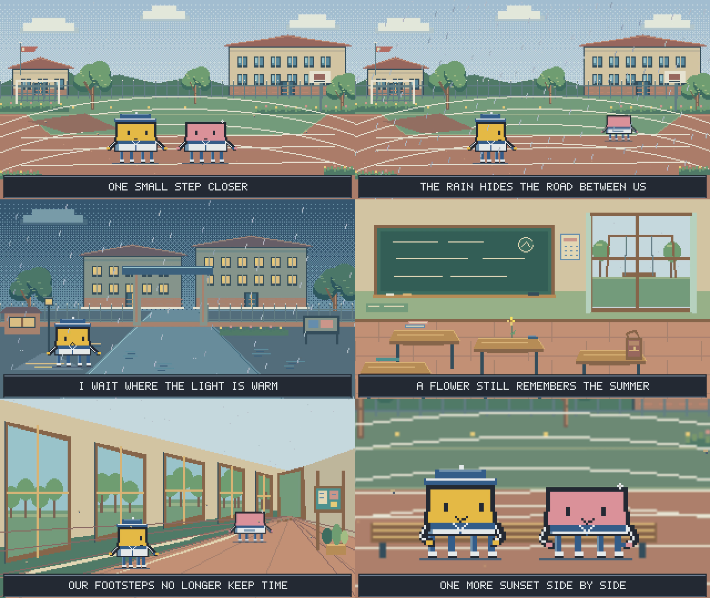

# 像素游戏 MV · Pixel Game MV

人物关系驱动的像素MV技能，附彩色校园实例、本地工作台和导出工具。白蓝校服、七套320×180场景、关键姿态与48fps采样均有实际代码。



[60秒实例](demo.mp4) · [Skill入口](SKILL.md) · [完整制作方法](WORKFLOW.md) · [审计与修复](AUDIT.md)

**v1.1补齐新歌制作链。** v1.0主要能复现旧片，新歌分镜没有接到动作程序；仅改歌词或时间仍可能播旧剧情。现新增独立工程、可执行事件/姿态分镜、统一原声配置与按项目检查。已有校园视频不重画。

## 先核实运行能力

把整个仓库交给能读取文件、写代码和运行工具的AI。普通聊天只读链接不等于下载、执行或生成视频。只能读文字时交付方案，能写但不能运行时交付未验证工程，实际视频必须有相应执行工具；不能编造MP4、下载链接或检查结果。

可直接给AI：

> 请实际读取此仓库的SKILL.md与WORKFLOW.md，先核实能否读取音频、保存文件、运行Node/浏览器/FFmpeg。按我的歌曲、歌词和脚本制作MV，不能运行就明确只做设计。用create-project.mjs在仓库外建工程，从人物关系设计场面、完整姿态、回应与接镜，将执行内容写入director-plan.json。先做能保留进成片的正式代表段，配原声粗排、修正后补过渡。交付实际视频、工作台、唯一分镜与真实检查范围，不只替换校园示例字幕。

## 运行已有实例

需要Node.js≥22、Chrome/Chromium或Edge、FFmpeg与ffprobe。预览/导出不用Python；改绘背景才需Python+Pillow。

```sh
npm ci
npm run preview
```

打开提示地址，播放、定位、静音及开关字幕。首次只为此实例生成原创示例音乐，不公开私人歌曲、歌词或系统字体。

```sh
npm run render
```

输出output/mv.mp4（本例1920×1080、48fps、60.03秒）；已有文件则停止，改名用`--out output/mv-v2.mp4`。浏览器位置用CHROME_PATH，端口用PORT。临时目录与独立Chrome缓存默认.cache/render，可用PIXEL_RENDER_ROOT改到其他盘，不改全局环境。

## 制作新歌

```sh
npm run new -- --dir ../My-MV --audio /path/song.mp3 --lyrics /path/lyrics.txt
```

脚本原样保存输入、签名和实测音长，创建空设计工程，不自动套校园告别剧情。**按[WORKFLOW.md](WORKFLOW.md)完成关系、场面、姿态与镜头设计**，再在新工程运行：

```sh
npm ci
npm run preview
npm run render -- --start 0 --end 8 --blocking true --out output/blocking.mp4
```

0—8只是区间用法示例，要改为有用途的正式代表段。粗排成立后补必要过渡，取消blocking输出；再接续全曲。空分镜和缺原声会停止，不替补示例音乐。默认导出读取当前工程音频、宽度和帧率。

| 入口 | 实际职责 |
| --- | --- |
| director-plan.json（新工程生成） | 唯一事件、完整姿态、场景、字幕和镜头时间源 |
| acting-example.json | 一段先后回应与接镜的完整写法，输入占位须换成真实输入 |
| timeline.mjs / plan.mjs | 新镜头执行、事件引用、分通道补间、全场粗排及结构检查 |
| mv.js / assets/campus | 已有方块画法与校园素材，独立保留旧片复现 |
| run.mjs / render.mjs | 统一配置、浏览器按秒取帧、FFmpeg原声导出 |
| mix-audio.mjs | 可选，从实际events取音效时间，保留原曲并统一合播 |
| check.mjs | 当前项目技术检查，不自动验表演 |

复杂道具、精细手指、新角色需补实际绘制，不能只在分镜写出来。中文需本机CJK字体并查看实际字幕。坐标、字段、素材补法、合成与局部返修在WORKFLOW一处维护。

## 验证与边界

```sh
npm test
npm run check -- output/mv.mp4
```

测试新流程的数据驱动、完整姿态与非法时间；检查按当前项目执行，不再认旧片固定秒数。实际覆盖见[AUDIT.md](AUDIT.md)。技术通过不等于动作自然、语义或混音通过，未完成的连续视听不能补签。

Windows为实际验证环境，其他系统未实机验证。可以复现所附画法并制作新片；不保证任意聊天模型只读链接就能执行全部工具或自动达到艺术效果。

代码、生成背景和原创示例声音采用[MIT](LICENSE)；基础像素工具保留[上游出处和许可](THIRD_PARTY_NOTICES.md)。用户另行接入的歌曲、字体和素材遵循各自许可。
